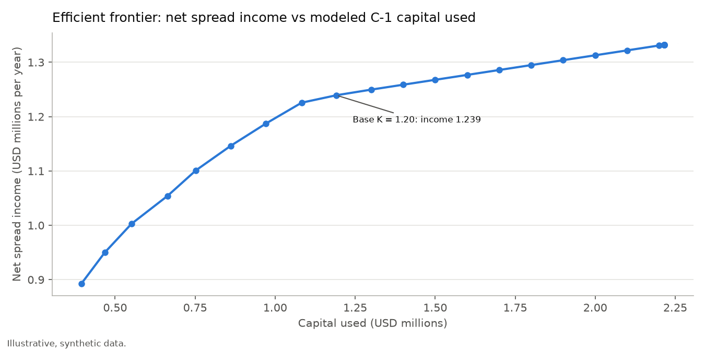
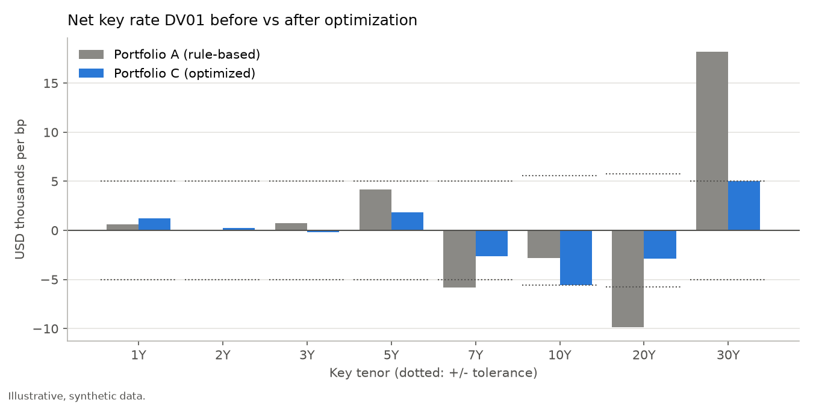
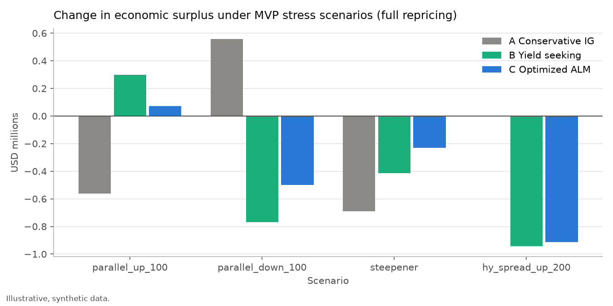

<!-- GENERATED FILE: edit docs/templates/README.md.tmpl, then run scripts/run_all.py. Numbers come from outputs/metrics.json. -->
# NAIC-Constrained Insurance ALM Model Portfolio

**Capital charge, KRD exposure and cash flow matching for a hypothetical U.S. life insurer**

This project is a reproducible Python model that builds a fixed income model portfolio (Investment Grade, High Yield and Structured Products) for a hypothetical life insurer. It optimizes expected net spread income subject to three constraints:

- a simplified NAIC Life RBC C-1 bond capital budget
- key rate duration (KRD) limits against the liabilities
- a cash flow funding test

> **Educational model on illustrative, synthetic data.** It is not production insurance modeling, not an actuarial valuation, and not a statutory RBC calculation. No output is an RBC ratio. Every assumption is labeled in [docs/assumptions.md](docs/assumptions.md).

## Business case

The insurer holds **$100M** of investable assets against fixed / payout annuity and life liabilities with **PV $90M**. The liabilities have a Macaulay duration of 10.1 years and a DV01 of $85.7k per bp. The portfolio manager wants more spread income, but every extra dollar of spread costs something:

- **Regulatory capital**: NAIC C-1 factors rise steeply below investment grade, and new 12/31/2026 factors apply to CLOs.
- **Interest rate risk**: economic surplus is exposed to curve moves, not just parallel shifts.
- **Liquidity**: asset cash flows must fund liability payments in years 1–10.

## Method

| Module | What it does | Code |
|---|---|---|
| Fixed income analytics | Spot-curve pricing, YTM, Macaulay / modified / effective duration, convexity, DV01, KRD (triangular 1bp bumps at 1, 2, 3, 5, 7, 10, 20 and 30Y), spread duration | `curve.py`, `bonds.py`, `krd.py` |
| Universe | 34 securities: Treasuries / STRIPS, IG and HY corporates, Agency MBS (CPR), non-agency RMBS, CMBS (balloon), ABS, CLO floaters. Includes a sequential-pay waterfall demo | `structured.py`, `universe.py` |
| Liabilities | Hump-shaped benefits + surrenders + expenses, scaled to the target PV | `liabilities.py` |
| **A. Cash flow matching** | Annual gaps, coverage, cumulative funding balance with reinvestment at 1Y forwards and borrowing at forward + spread | `cashflow_matching.py` |
| **B. KRD exposure** | Asset vs liability key rate DV01, duration gap, surplus scenarios by full repricing vs the KRD approximation | `krd_exposure.py` |
| **C. NAIC capital** | Market value × C-1 factor by designation; 2026 CLO factors (thin-tranche surcharge for BSL tranches at 2.C or below) | `capital.py` |
| Optimization | LP (CVXPY + HiGHS): max Σ x(s − EL) subject to capital, per-tenor KRD and surplus DV01, funding, bucket / issuer / liquidity limits, **full-repricing scenario surplus limits** and a **downgrade capital buffer**. Reports duals, slack and binding rows, the frontier, and infeasibility diagnosis | `optimizer.py`, `scenario_constraints.py` |
| Portfolios and stress | A (conservative IG), B (yield seeking), C (optimized); 13 stress scenarios; robustness simulation with out-of-sample check | `portfolios.py`, `stress.py`, `robustness.py` |
| Phase 6 analytics | Rate-dependent Agency MBS prepayment (negative convexity), spread DV01, notch-downgrade sensitivity, receive-fixed swap overlay | `structured.py`, `migration.py`, `overlay.py` |

### Matching concepts in one paragraph

- **Cash flow matching** checks year-by-year funding: does each year's asset inflow, plus any balance carried forward, cover that year's liability outflow?
- **Duration matching** equates asset and liability DV01, which protects surplus against *parallel* moves only.
- **KRD matching** equates DV01 tenor by tenor, which also protects against *curve-shape* moves.

Portfolio A shows why all three are needed. Its duration gap is only +0.53 years, but its net key rate DV01 is +18.2k at 30Y and -9.9k at 20Y (USD per bp), so a steepener changes its surplus by -0.69 (USD millions). See [docs/methodology.md](docs/methodology.md).

### Worked toy example (cash flow funding)

| Year | Assets | Liabilities | Gap | Cumulative (before reinvestment) |
|---|---|---|---|---|
| 1 | 6 | 4 | +2 | +2 |
| 2 | 3 | 5 | −2 | 0 |

With reinvestment at 4%, the year-2 balance is 2 × 1.04 − 2 = +0.08 (`tests/test_cashflow_matching.py`). <!-- static -->

## Key results

All figures are in USD millions unless noted and come from [outputs/metrics.json](outputs/metrics.json). Capital budget K = $1.20M.

| Metric | A Conservative IG | B Yield seeking | C Optimized ALM |
|---|---|---|---|
| Net spread income (after EL), per year | 0.612 | 1.266 | 1.239 |
| Expected credit loss, per year | 0.024 | 0.143 | 0.094 |
| Portfolio yield | 4.84% | 5.61% | 5.56% |
| Asset effective duration (years) | 9.10 | 8.01 | 8.27 |
| Surplus DV01 ($k per bp; limit ± 5) | +5.3 | -5.5 | -3.0 |
| Max \|net key rate DV01\| ($k per bp) | 18.2 | 14.1 | 5.6 |
| Key rate tenors outside tolerance | 3 | 2 | 0 |
| **Rate limits met (surplus DV01 and every KRD tenor)** | **False** | **False** | **True** |
| Modeled C-1 charge (budget utilization) | 0.435 (36%) | 1.679 (140%) | 1.191 (99%) |
| Capital efficiency (net income / charge) | 1.41 | 0.75 | 1.04 |
| Δ surplus, rates +100bp | -0.56 | +0.30 | +0.07 |
| Δ surplus, rates −100bp | +0.56 | -0.77 | -0.50 |
| Δ surplus, steepener (−50bp at 1Y to +50bp at 30Y) | -0.69 | -0.41 | -0.23 |
| Δ surplus, HY (NAIC 3+) spreads +200bp | +0.00 | -0.94 | -0.91 |

- Stress capital uses a book-value proxy (t0 market value × factor). The mark-to-market charge is reported as a sensitivity in `outputs/tables/stress_mvp.csv`.
- **Portfolio A breaches the surplus DV01 limit** (+5.34k vs ± 5k) once Agency MBS prepayment responds to rates. Under constant CPR it was +4.81k. Static allocations drift out of tolerance when prepayment behavior changes.

**Optimization findings**

- **Shadow price of the capital budget K: 0.107.** K appears in two rows, the C-1 charge ≤ K and the post-downgrade charge ≤ 1.10·K. So dIncome/dK = dual_capital + 1.10 × dual_buffer. At the base budget, one more dollar of K adds about $0.11 a year of net spread. The value is 0.62 at K = $0.40M and 0 once capital used reaches $2.22M, where the frontier tops out at 1.332 and the HY, CLO and issuer limits bind instead.
- **Why the LP does not swap more BBB into HY.** A $1M BBB → BB+ swap earns 0.55% of spread for 1.63% of capital, but the HY (NAIC 3+) limit is binding with a dual of 0.0082. Priced at all binding duals, the swap's reduced cost is 0.0e+00.
- **CLO factor regime.**
  - (a) C's holdings repriced on the old bond factors need $1.047M of capital, versus $1.191M under the 2026 CLO factors.
  - (b) Re-optimized on the old factors, the LP buys more CLO BB (0.43 → 5.00) and earns 1.332 using $1.099M of capital.
  - The 2026 factors raise BBB tranches to 3.240% (from 1.523%) and BB tranches to 25.150% (from 4.537%).
- **Robustness and the optimizer's curse.** Over 500 draws (spreads × N(1, 0.10), PDs × mean-one lognormal with σ = 0.25):

  | | Mean income |
  |---|---|
  | Re-optimized, in-sample | 1.251 |
  | Base C held fixed, same draws | 1.237 |
  | Re-optimized, out-of-sample | 1.230 |

  - The in-sample gap of +0.0136 is the optimizer's curse.
  - Out-of-sample, re-optimized portfolios minus fixed C: -0.0077.

C does not win every metric. A has the best capital efficiency and gains when rates fall, and B earns slightly more income by breaking the capital and rate limits. C is the only portfolio inside every limit, and it pays for that with a short-duration position (-0.50 at −100bp) and more spread risk.

## Scenario constraints and downgrade buffer

The duration and KRD rows are linear, so they cannot see negative convexity. The model adds one exact, still linear row per curve scenario. Each row uses the full-repricing value change per dollar of every security, with cash flows re-projected on the shocked curve:

> ΔA_s(x) − ΔL_s ≥ −0.50 for s ∈ {+100bp, −100bp, steepener, flattener}

It also adds a **downgrade buffer**: capital after a one-notch BBB-family downgrade ≤ 1.10 × K. Both are switchable in `config/policy.yaml`. A test checks that the LP rows reproduce the stress engine's full-repricing ΔS exactly.

| Portfolio C | Before | After |
|---|---|---|
| Net spread income per year | 1.2485 | 1.2393 |
| Δ surplus, −100bp | -0.734 | -0.500 |
| Δ surplus, +100bp | +0.243 | +0.071 |
| Δ surplus, combined adverse (B: -4.525) | -4.621 | -4.350 |
| Surplus DV01 ($k per bp) | -5.00 | -2.99 |
| Capital after one-notch BBB downgrade (limit 1.32) | 1.329 | 1.320 |

- **Binding scenario:** −100bp, with a dual of 0.0426. Each extra dollar of allowed −100bp loss is worth about that much income a year.
- **Downgrade buffer:** binding, with a dual of 0.0972.
- **Costs in income:** the scenario rows cost 0.0083 a year, and the downgrade buffer a further 0.0009.
- **Combined adverse:** before the constraints C lost more than B; after them it loses less.
- **Optional HY-count row** (off by default): NAIC 3+ holdings after the same one-notch BBB downgrade ≤ 10. Switching it on cuts income to 1.1893, a cost of 0.0501 a year. It forces BBB− names out, because each of them becomes 3.A.

**The swap overlay with scenario constraints on.** Receivers make −100bp protection almost free:

| Allowed −100bp loss | Income, cash bonds only | Income, with overlay |
|---|---|---|
| 0.50 | 1.2393 | 1.2897 |
| 0.00 | 1.2181 | 1.2893 |

- Tightening the −100bp loss limit from the loosest to the tightest value costs 0.0213 a year with cash bonds, but only 0.0004 with the overlay.
- At the base limit, the −100bp dual falls from 0.0426 to 0.0005.

## Phase 6 analytics

**Negative convexity.** Agency MBS prepayment follows an S-curve in the 10Y rate (`config/prepayment.yaml`, illustrative):

| FNMA 30Y | Constant CPR | Rate-dependent CPR |
|---|---|---|
| Effective duration (years) | 6.48 | 6.91 |
| Effective convexity (±25bp) | 77 | -216 |

- The duration rows alone are linear and miss convexity, which is why the scenario rows above exist.
- For the final C, full repricing gives a surplus change of +0.07 at +100bp and -0.50 at −100bp, compared with +0.30 / -0.30 from the linear KRD estimate. Both directions come out worse.

**Spread DV01** (value lost per +1bp of spread, USD thousands). Treasuries and STRIPS have no credit spread and are excluded. Agency MBS spread is OAS / basis risk, not credit risk, so it is shown separately:

| | A | B | C |
|---|---|---|---|
| Credit spread DV01 (IG, HY, RMBS, CMBS, ABS, CLO) | 44.8 | 55.3 | 56.8 |
| Agency MBS OAS / basis DV01 | 6.7 | 12.3 | 11.3 |

CLO floaters carry almost no rate DV01 but full spread DV01.

**Downgrades (Portfolio C, all eligible holdings).**
- One notch adds 0.370 of capital, and two notches add 1.434, against a budget of 1.20.
- One notch lifts NAIC 3+ holdings to 15.0, above the 10 limit, because BBB− names become 3.A.

**Stress highlights** (all 13 scenarios: `outputs/tables/stress_all.csv` and figure `f4`):

| Scenario | A | B | C |
|---|---|---|---|
| Combined adverse (−100bp, IG +50, NAIC 3+ +200, BBB −1 notch): Δ surplus | -2.04 | -4.53 | -4.35 |
| Fallen angels (all BBB → 3.A): capital charge | 0.670 | 2.462 | 2.093 |
| Surrenders +50% in years 1–5: minimum funding balance, years 1–10 | -0.55 | +3.54 | +1.34 |
| NAIC 3+ defaults ×2, recovery −10 points: Δ net income per year | +0.000 | -0.128 | -0.061 |

- Surrenders are paid at the reserve value, so liability PV barely moves. The risk is liquidity: Portfolio A's funding balance goes negative.
- **Tighter capital (K × 0.75 = 0.90)**: C would sit at 132% of the new budget. Re-optimizing changes income by -0.093 a year, and NAIC 3+ holdings fall to 5.0.

**Receive-fixed swap overlay** (zero modeled C-1, carry -1bp a year, notional cap 50):

| | C | C with overlay |
|---|---|---|
| Net spread income per year | 1.239 | 1.290 |
| Treasuries / STRIPS held | 8.3 | 0.0 |
| Swap notional (20Y / 30Y) | – | 6.8 / 6.2 |
| Δ surplus, steepener | -0.23 | -0.03 |
| Δ surplus, −100bp | -0.50 | -0.50 |

- With all policy rows on, the overlay replaces zero-spread Treasuries with receivers and adds +0.050 a year. The −100bp result stays at the 0.50 limit; tighter limits are almost free (see the table above).
- Not modeled: derivative counterparty RBC, collateral, and margin liquidity.

**Prepayment sensitivity** (default rate-dependent CPR vs constant CPR, same holdings):

| | Surplus DV01 ($k/bp), rate-dep. / constant | Δ surplus −100bp, rate-dep. / constant |
|---|---|---|
| A | +5.34 / +4.81 | +0.559 / +0.645 |
| B | -5.54 / -6.34 | -0.770 / -0.612 |
| C | -2.99 / -3.71 | -0.500 / -0.363 |

## Charts

All charts are in `outputs/figures/`, and every chart is illustrative and uses synthetic data.

| Chart | Files |
|---|---|
| Cash flows, annual gap, cumulative funding (Portfolio A) | `a1`–`a3` |
| Asset vs liability KRD, net mismatch vs tolerance, bucket × tenor heatmap (Portfolio A) | `b1`–`b3` |
| Efficient frontier, KRD along the frontier, before vs after optimization (KRD, funding, capital) | `c1`–`c5` |
| Three-portfolio allocation, stress surplus, net KRD | `d1`–`d3` |
| Robustness: fixed C vs re-optimized income, position / issuer-cap frequency | `e1`–`e2` |
| MBS negative convexity, spread DV01, downgrade capital, all stress scenarios, swap overlay KRD | `f1`–`f5` |
| Scenario constraints before vs after, cost of tightening the −100bp limit | `g1`–`g2` |





## Reproduce

```bash
python3 -m venv .venv && .venv/bin/pip install -r requirements.txt
.venv/bin/python scripts/run_all.py    # every table, chart, metrics.json, and this README
.venv/bin/python -m pytest -q          # unit tests, including README / IC numbers vs metrics.json
```

The random seed is 42 everywhere. All assumptions live in `config/`.

## Limitations

- Market data, spreads, PDs, recoveries, CPRs and the liability block are synthetic.
- Liability cash flows do not respond to rates (no dynamic lapse), which understates rate risk. The Agency MBS prepayment S-curve is illustrative, not fitted to data.
- **The liability block is closed and terminates at year 30.**
  - The same benefit shape run to year 60 (flat curve beyond 30Y) would have 2.8% of its PV after year 30.
  - The reserve V_t only runs to year 30, so surrenders in the last ten years are 45% of what an open-ended block would pay.
- The swap overlay result depends on a zero swap spread, no collateral or margin, and a carry of -1bp a year.
- Annual time steps; credit losses use a bond-level PD; designations for structured bonds are illustrative.
- C-1 charge = value × factor (book-value proxy under stress). There is no bond size factor, tax, covariance or RBC ratio. Derivatives carry no modeled capital.
- The LP is linear and lands on corner solutions; see the robustness simulation.

## Backlog

- Real U.S. Treasury curve loader (dated par curve, bootstrapped to spot)
- Simple RBC covariance illustration (clearly labeled, illustrative non-C-1 inputs)
- Dynamic lapse: surrenders rise when rates rise (liability cash flows are currently fixed under rate shocks)

## Sources

- **C-1 bond factors (current, 20 designations):** 1.A, 2.B and 3.A checked against the Proposal 2026-12-IRE LR002 form (Column 1); the other 17 from Mayer Brown (July 2026, “Current” column), consistent with the 2021 Moody's Analytics base factors. Not yet checked line by line against the full LR002 instructions.
- **CLO factors:** all 20 designations and the 45% residual checked against the adopted Proposal 2026-12-IRE LR002 form. Proposal 2026-12-IRE MOD was adopted by the RBC Investment Risk and Evaluation (E) Working Group (6/23/2026) and the Capital Adequacy (E) Task Force (6/30/2026).
- **References:** Mayer Brown (July 2026), "The NAIC RBC Investment Risk and Analysis (E) Working Group Has Made Its Decision on New Life RBC Factors for CLOs"; Sidley, "NAIC Adopts New RBC Charges for Collateral Loans and CLOs" (July 2026).
- The thin-tranche line (7.2) is ambiguous between an add-on and a replacement factor; this model uses the add-on reading (see [docs/assumptions.md](docs/assumptions.md)). <!-- static -->

Further documents: [methodology](docs/methodology.md) · [assumptions](docs/assumptions.md) · [investment committee summary](docs/investment_committee_summary.md)
